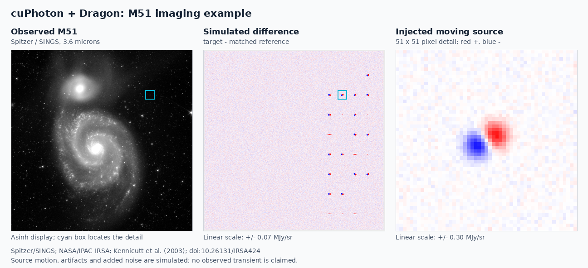

<!-- SPDX-FileCopyrightText: Copyright (c) 2026 NVIDIA CORPORATION & AFFILIATES. All rights reserved. -->
<!-- SPDX-License-Identifier: Apache-2.0 -->

# cuPhoton imaging with Dragon

[Open the notebook](run_dragon_imaging.ipynb) for a 35-minute walkthrough of
FITS loading, WCS registration, subtraction, candidate fitting, classification,
and a persistent GPU pipeline. Each distributed stage shows its Python
calculation and executable cuPhoton commands for one host, Slurm, and SSH.
The optional transient-chain section adds 5–7 minutes of detection and
uncertainty analysis.

The background is a real Spitzer/SINGS image of M51. Source motion, detector
artifacts, noise, and classification labels are simulated. The example trains
a small triplet-plus-xFit classifier on controlled injections before the
presentation. Its held-out metrics describe that experiment, not performance
on independently observed transients.



## Prepare before the session

Use Linux, Python 3.12, CUDA 13, and a GPU with enough memory for the prepared
1024×1024 pairs. Use one checkout revision and matching native extensions on
all participating nodes. The command cells require Bash, GNU `time` at
`/usr/bin/time`, and GNU `timeout`. Run these commands from the repository root:

```bash
uv sync --locked --python 3.12 --extra gpu --extra dragon --extra viz
source .venv/bin/activate
# Required only for the optional transient-chain section:
uv pip install -e examples/transient-chain
```

Build xDR using the [xDR source instructions](../../docs/components/xdr.md#native-extension-availability)
and build native xFit plus imaging using the
[native build instructions](../../docs/components/xfit.md#optional-native-cuda-backend).
The latter extension supplies native xRep, xPois and compressed-pixel
restoration too. Select architecture targets for the actual presentation GPUs.
The GPU dependency extra alone does not build these extensions. After a native
editable build, use `uv run --no-sync` or the activated environment to preserve
it; do not resynchronize away the selected build.

Prepare data and train at the final absolute location. Choose a shared path
for a multinode session; the local example below is ignored by Git:

```bash
export CUPHOTON_DEMO_ROOT="$PWD/scratch/sc26-dragon"
python examples/dragon-imaging-pipeline/prepare.py \
  --output "$CUPHOTON_DEMO_ROOT" --seed 2026 --images 8
```

Preparation verifies the archive download, saves controlled image pairs and
candidate stamps, trains the small model for 20 epochs on GPU `cuda:0`, retains
the checkpoint with the best validation ROC AUC, selects its threshold on
validation data, evaluates held-out data on the GPU, and writes
the workload manifests. The result is `prepared.json`; it is published only
after preparation completes.
A completed preparation can be reused with the same inputs and package versions.
Changed seeds, settings, or installed package versions require a new output
directory; the existing prepared data remain usable by the notebook. To prepare without downloading, add
`--source /path/to/ngc5194_v7.phot.1.fits`; the same size and checksum checks apply.
Do not move a prepared directory: its descriptors contain absolute paths.

The training parameters are visible in [train.example.yaml](train.example.yaml).
The qualified run completed all 20 epochs and retained epoch 1; later epochs
improved training loss while validation ranking deteriorated. The notebook
shows the retained epoch and compact history. Its uncalibrated scores occupy a
narrow range near 0.5, so it also shows logits and ranks. The preparation gate
only rejects training that fails to beat the held-out majority-class baseline;
it does not qualify the model for survey use.
With batch size 32, GPU training reserved approximately 22 GiB at peak on an
RTX PRO 6000 during preparation. Leave GPU memory headroom for training; this
measurement is specific to that configuration and includes PyTorch's allocator
reserve.
Keep `training/evaluation.json`, the checkpoint, feature schema, data manifest,
and preparation receipts together. Training, validation and test source
positions have separated pixel footprints. They still share one archival
mosaic, so the exercise does not establish cross-survey generalization.

Install and launch Jupyter in the prepared environment:

```bash
uv pip install --python .venv/bin/python jupyterlab nbclient
python -m ipykernel install --user --name cuphoton-sc26 \
  --display-name 'cuPhoton SC26 (Python 3.12)'
jupyter lab examples/dragon-imaging-pipeline/run_dragon_imaging.ipynb
```

To include the optional transient-chain section, set
`export CUPHOTON_DEMO_TRANSIENT_CHAIN=1` before launching Jupyter.

Select that kernel, restart it, and run all cells. The notebook records actual
versions and the GPU. Its outputs go to a fresh directory beneath
`$CUPHOTON_DEMO_ROOT/runs/`; rerunning the setup cell chooses a new run name.
The committed notebook has no saved outputs. Keep an executed copy and its
figures in the run directory for rehearsal and offline presentation. If that copy
is served outside the checkout, also set `CUPHOTON_DEMO_REPO` to the checkout's
absolute path before starting its kernel.

The actual CLI commands live in `%%bash` cells, followed by Python inspection
cells. Setup exports input paths and selects the kernel environment's tools on
`PATH`; it does not construct commands. Each Bash cell uses `set -euxo pipefail`,
a 10-minute timeout, a regular-file `<stage>.log`, and a GNU `time` record
`<stage>.elapsed` containing launcher-to-exit wall seconds. The last 40 log lines
are displayed on exit, including failures. No command output is piped through a
logging subprocess.

## Select hosts and GPUs

The executable Bash cells use `dragon -s` for one host. No host file or dummy
network manifest is needed. Set the worker cap before launching Jupyter:

```bash
export CUPHOTON_DEMO_WORKERS=1
```

Every distributed stage has complete Slurm and SSH alternatives immediately
below its Bash cell. To run on a cluster, replace that cell's `dragon -s ...`
command with the selected literal alternative, keeping its timing and log
redirection. For Slurm, start Jupyter inside an interactive allocation and set:

```bash
export CUPHOTON_DEMO_NODES=2
export CUPHOTON_DEMO_WORKERS=8
```

Do not exceed the allocation's GPU count. On multiple nodes, the environment,
checkout, data and writable run directory must be visible at identical absolute
paths, with the same CPU architecture and runtime versions.

For dedicated hosts reached through noninteractive SSH, set
`CUPHOTON_DEMO_HOSTFILE` to a file containing one actual hostname per line,
without comments or blank lines, and use the literal SSH command. Dragon's SSH
backend does not inherit the launching shell's GPU visibility mask; use only
authorized hosts and GPUs. See the [launch guide](../../docs/distributed-execution.md)
for site network selection and scheduler requirements.

The YAML `pairs.yaml` describes image-pair work. `pipeline.json` describes the
model and resident pipeline. Neither file configures Dragon's hosts or network.
Each xPois/pipeline item is a complete pair; xFit distributes candidate chunks
and xScan distributes whole inference minibatches. More candidates in one pair
do not create more pipeline workers.

## Read the comparisons

The complete notebook, native comparisons, and optional transient-chain section
have been executed in a clean kernel on one RTX PRO 6000 GPU with one local
Dragon worker. Slurm and SSH launch forms are provided, but multiple hosts and
multiple GPUs have not been validated with this example. These results establish
local execution and numerical agreement, not distributed scaling.

The same explicit numerical settings are used on both sides: CuPy, float64
Gaussian fitting, xFit solver policy `v0.2`, and fixed candidate/minibatch sizes.
The notebook checks scientific arrays and candidate ordering, then displays
worker placement and completion records. Failed commands and timeouts raise an
error and retain their logs. Inspect those logs and actual worker cleanup
before retrying with a fresh run. The shell timeout bounds the launcher, not
all worker lifetimes. Use `dragon-cleanup` only in an isolated allocation that
contains no other Dragon sessions; it can affect other users on a shared host.

The resident pipeline first runs through the local `cuphoton xscan run-pipeline
--executor processes` command with one worker on the notebook's first visible
GPU, then through the same command with Dragon and the selected worker cap.
Both process the complete corpus with one warmup and three measured rounds.
A separate one-pair Python example exposes the API without repeating the full
benchmark. Each worker loads the model once and retains intermediate images
on the GPU. The notebook checks all 22 scientific arrays against the final local
round, skipping that baseline's self-comparison: 40 independent item-round
comparisons for the default eight pairs. It also compares saved-feature scores
with scores from resident feature recomputation, and displays fixed examples
from each injected class alongside the classifier's logits, ranks and decisions.

The CLI batch timers include dispatch, input loading, computation and worker
outputs. Keep actual worker counts, setup, validation, shutdown and total
launcher time visible. The one-pair Python timer has a different boundary and
is not a throughput baseline. Small workloads demonstrate execution, not
representative scaling or guaranteed speedup. Image decoding receipts do not
establish native GPUDirect Storage or hardware decompression.

The native comparison covers compressed xDR restoration, xRep reprojection,
xPois constant-kernel fitting and Gaussian xFit. Native xRep and xPois include
matching local CLI comparisons. xDR's CLI counterpart is a decoding benchmark;
the API cells check its restored pixels. Compact-source selection has no exact
standalone CLI counterpart. Native xFit works under Dragon
and in the resident pipeline. The current xPois batch command and the resident
pipeline's xPois stage still use their supported CuPy path; the example does
not claim an entirely native pipeline. Native implementations retain CuPy-owned
buffers and require the corresponding built extensions. The notebook reports
native/CuPy center differences and strict comparison counts for every candidate,
alongside convergence and uncertainty flags. It separately checks identified
moving-source centers; fitting a Gaussian dipole to detector artifacts does not
establish well-constrained centers.

The optional [transient-chain](../transient-chain/README.md) application has
its own launcher and automatically detects candidates and adds quality and
uncertainty information. Run it without a checkpoint here: it expects an
image-only classifier, while this demonstration trains a fusion classifier.
Its current CuPy path does not expose the native switches.

## Check the example helpers

Run the focused CPU tests from the prepared environment:

```bash
python -m pytest examples/dragon-imaging-pipeline/tests -q
```

These cover data and preparation contracts plus display/summary helpers. They do
not replace the clean-kernel GPU execution or qualify a multinode launch.

## Data and attribution

The pinned input is the 3.6 μm IRAC channel 1 mosaic
`ngc5194_v7.phot.1.fits` from the
[Spitzer Infrared Nearby Galaxies Survey archive](https://irsa.ipac.caltech.edu/data/SPITZER/SINGS/galaxies/ngc5194.html),
[dataset DOI 10.26131/IRSA424](https://doi.org/10.26131/IRSA424).
Credit Spitzer/SINGS, NASA/IPAC Infrared Science Archive, and Kennicutt et al.
(2003). IRSA's [data-use policy](https://irsa.ipac.caltech.edu/data_use_terms.html)
permits use of public archival data without restrictions; this is not a
separate public-domain declaration. Follow its
[acknowledgment guidance](https://irsa.ipac.caltech.edu/ack.html) when sharing results.

[source-data.json](source-data.json) records the exact URL, size, SHA-256, units,
HDU, crop and attribution. The archive is downloaded at preparation time;
FITS files, generated arrays, model weights and run evidence are not committed.
The modified pair headers identify them as simulations. Surface-brightness
units remain MJy/sr; the added variance describes the injected target noise,
not a complete error model for the archived mosaic and all its correlations.
